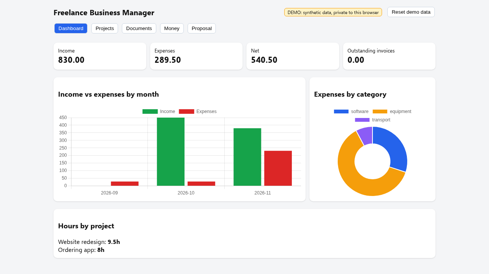
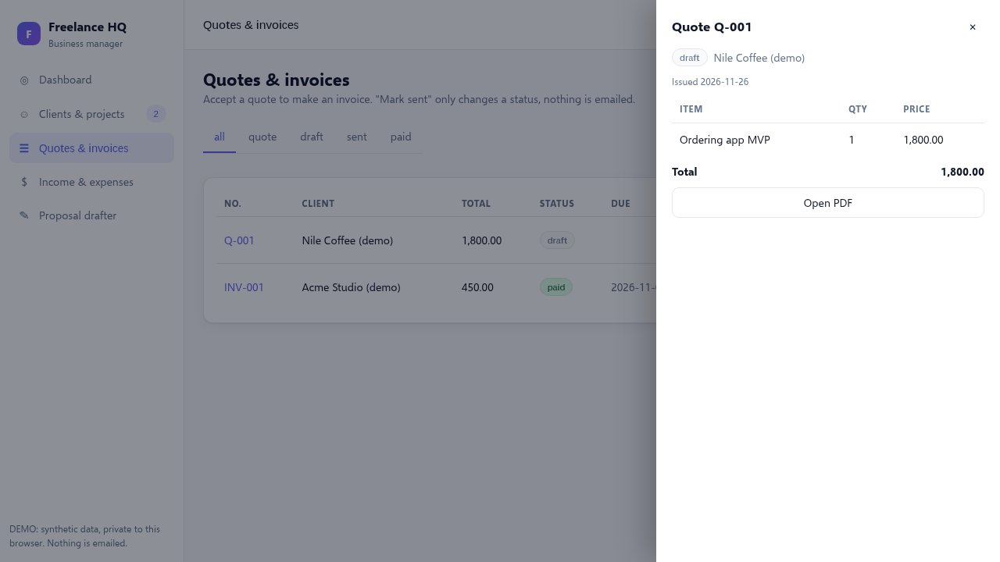
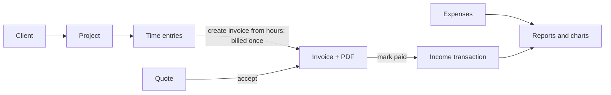

# Freelance Business Manager

[](https://github.com/ZeyadMohamed00/freelance-business-manager/actions/workflows/ci.yml)

Track clients, projects, hours, quotes, invoices (with PDF), income and expenses, see reports, and draft project proposals.

**Live demo:** https://freelance-web-taupe.vercel.app (API: https://freelance-api-liart.vercel.app/docs)
Open it and you get synthetic demo data (clearly labeled), private to your browser. "Reset demo data" wipes it. Nothing is ever emailed; "Mark sent" only changes a status.




Pages: Dashboard (Chart.js), Clients and projects, Quotes and invoices (multi-line quote builder, PDF), Income and expenses (CSV export), Proposal drafter (can create a quote from the draft).

## System overview


**Tech stack:** React, TypeScript, Vite, Chart.js, FastAPI, PostgreSQL, fpdf2, Pytest, Vitest, Docker.

## Stack
React + TypeScript (Vite) with Chart.js, FastAPI, PostgreSQL (SQLAlchemy), fpdf2 for PDFs, optional LLM API for proposals. Docker + docker-compose. Tests: pytest (real embedded Postgres) and vitest.

## Status, honestly
- Verified: 9 API tests on a real Postgres, 2 frontend tests, production build, and a real-browser click-through of the live site (seed data, create invoice from hours, mark paid, charts update).
- **AI proposal feature:** the LLM call is written (set `OPENAI_API_KEY`, optional `LLM_MODEL`) but **was never run**, there was no key. Without a key the app uses a deterministic template and the UI labels the result "template (no LLM key configured)".
- Docker files are written but were not built here (no Docker in the build sandbox).
- CI workflow is in `.github/workflows/` (the push token lacked `workflow` scope); move it to `.github/workflows/`.

## Run
```
docker compose up --build            # API on :8000
# or
pip install -r requirements.txt && DATABASE_URL=postgresql+psycopg2://... uvicorn fb.main:app
cd frontend && npm install && npm run dev
pytest -q && cd frontend && npm test
```

## How it works / key decisions
- **Hours are billed once.** "Create invoice from hours" turns every unbilled time entry into a line item and stamps the entry with the invoice id. A second click returns 409.
- **Quote to invoice.** Accepting a quote copies its items into a new invoice due in 14 days.
- **Income comes from paid invoices.** Marking an invoice paid writes an income transaction, so reports and the invoice list cannot drift apart. Manual income and expenses go in the same table.
- **Money is stored as floats and rounded at output.** Fine for a demo; use integer cents or Decimal for real accounting.
- **Seeding is serialised** with a Postgres advisory lock per demo user. The UI fires several requests at once on first load, and without the lock the seed ran twice (found in the live browser check and fixed).
- Reports are computed in the API (`/report`), the UI only draws them.

## 5 things to understand
1. The one-to-many chain: client, project, time entries, invoice, payment, income.
2. Why billed hours are stamped (no double billing).
3. Why income is derived from paid invoices.
4. The demo-user header is isolation, not security.
5. The proposal feature has two modes and only the template mode has been run.

## Accounts and persistence
- **Real accounts:** `POST /auth/register`, `POST /auth/login`, `GET /auth/me`. Passwords are salted PBKDF2-SHA256 hashes; sessions are signed JWTs (7 days) sent as `Authorization: Bearer`. Set `JWT_SECRET` in production; if it is unset, a secret is derived from `DATABASE_URL`.
- **Persistence:** a signed-in user's data is stored in PostgreSQL under their own account key (`user:<id>`) and is only reachable with their token. New accounts start empty.
- **Guest demo:** without logging in, "Continue as guest" uses an anonymous browser id with clearly labeled sample data. Guest ids can never collide with or impersonate an account.
- Tests: `tests/test_auth.py` (register, login, wrong or weak password, duplicate email, bad token, isolation) and `frontend/src/auth.test.tsx`.
- Not built: email verification, password reset, rate limiting and refresh tokens (listed as next steps).

## Database migrations

Schema changes are versioned with Alembic (`migrations/`, baseline `0001`). Point `DATABASE_URL` at the database and run `alembic upgrade head`. The baseline was generated from the models and checked by running upgrade, downgrade and upgrade again on SQLite; I did not run it against a fresh PostgreSQL instance here. The running app still creates missing tables on start.
